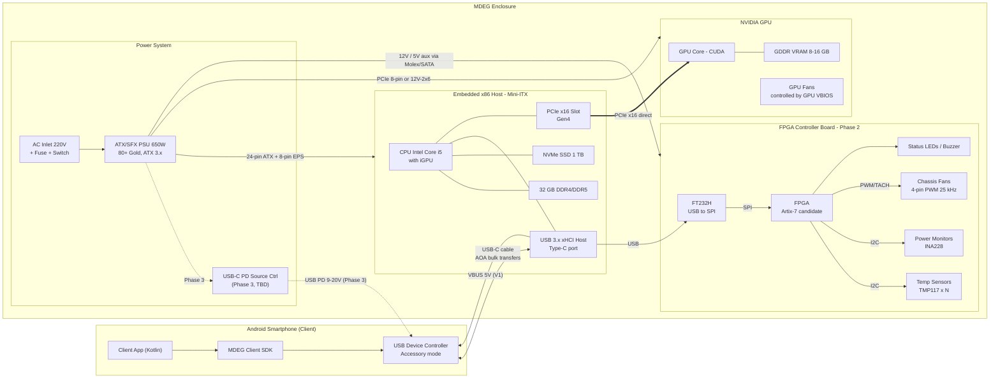
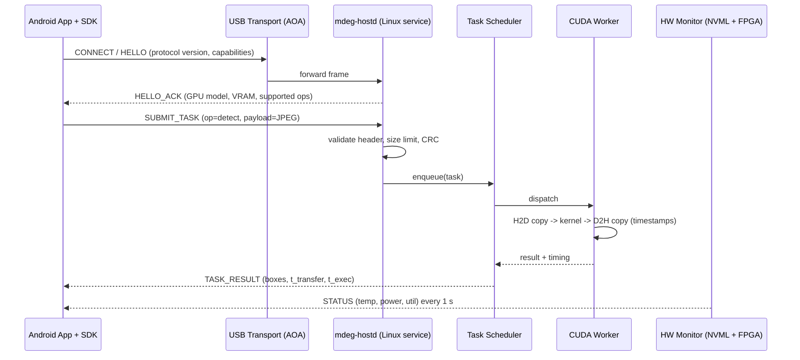

# MDEG — Phase 0: Feasibility Study Report

| รายการ | ค่า |
|---|---|
| เอกสาร | `docs/feasibility/PHASE0_FEASIBILITY_REPORT.md` |
| เวอร์ชัน | 0.1 (Draft — รอการอนุมัติ) |
| วันที่ | 2026-11-04 |
| สถานะ | **Proposed** — ยังไม่มีการตัดสินใจด้านฮาร์ดแวร์ใด ๆ ที่ถือว่า final |
| ผลการทดสอบ | **ยังไม่มีการทดสอบบนฮาร์ดแวร์จริงหรือ simulation ใด ๆ** ตัวเลขทั้งหมดในเอกสารนี้เป็น *ค่าประมาณทางทฤษฎี* |

> **กติกาการอ่านเอกสารนี้**
> - `[EST]` = ค่าประมาณ (estimate) ต้องตรวจสอบกับ datasheet / ราคาตลาดจริงก่อนซื้อ
> - `[TBD]` = ยังไม่ทราบ ต้องรอข้อมูลจากผู้ใช้หรือการทดลอง
> - `[VERIFY]` = เป็นข้อมูลที่เชื่อว่าถูกต้อง แต่ต้องยืนยันกับเอกสารผู้ผลิตก่อนใช้ตัดสินใจ

---

## 0. สรุปผู้บริหาร (Executive Summary)

**คำตอบสั้น: MDEG สร้างได้จริง (feasible)** ด้วยชิ้นส่วนที่หาซื้อได้ทั่วไป โดยมีเงื่อนไขสำคัญ 3 ข้อ:

1. **MDEG ไม่ใช่ "eGPU" แบบที่ GPU ต่อเข้า PCIe ของมือถือ** — มือถือ Android ไม่มี PCIe ออกภายนอก และ Android ไม่มี NVIDIA driver
   สิ่งที่เราสร้างจริงคือ **"USB-attached GPU compute appliance"**: คอมพิวเตอร์ x86 ขนาดเล็กที่มี NVIDIA GPU อยู่ในกล่อง
   มือถือส่ง "งาน" (task + data) ผ่าน USB-C แล้วรับ "ผลลัพธ์" กลับ
2. **คอขวดหลักคือแบนด์วิดท์ USB ของมือถือ ไม่ใช่ GPU** — มือถือหลายรุ่นมีพอร์ต USB 2.0 (480 Mbit/s) แม้จะเป็นหัว USB-C
   งานที่เหมาะคืองานที่ "คำนวณเยอะ แต่ข้อมูลเข้า-ออกน้อย" เช่น AI inference / object detection
   งานอย่าง matrix multiplication ขนาดใหญ่ที่ต้องส่งข้อมูลดิบไปกลับ **มีแนวโน้มช้ากว่ารันบนมือถือเอง** (ต้องพิสูจน์ด้วย benchmark)
3. **มีแค่แอปที่ใช้ MDEG SDK เท่านั้นที่ได้ประโยชน์** — แอปทั่วไป (เกม, กล้อง) จะไม่ใช้ GPU ภายนอกโดยอัตโนมัติ

**สถาปัตยกรรมที่แนะนำสำหรับ Prototype V1:**
Mini-ITX x86 motherboard + Intel Core i5 (มี iGPU) + 32 GB RAM + NVMe + NVIDIA RTX GPU บนสล็อต PCIe x16 + ATX/SFX PSU 650 W
+ Ubuntu 24.04 LTS + CUDA และเชื่อมกับมือถือผ่าน USB-C โดยใช้ **Android Open Accessory (AOA)** เป็น transport หลัก
FPGA ยังไม่ใส่ใน V1 (เข้ามาใน Phase 2)

---

## 1. MDEG System Architecture

### 1.1 แนวคิดหลัก (Mental model)

เปรียบเทียบให้เข้าใจง่ายสำหรับนักศึกษา CS:
MDEG ทำงานเหมือน **"server ส่วนตัวที่เสียบสาย USB"** — มือถือเป็น client, กล่อง MDEG เป็น server ที่มี GPU
ต่างจาก cloud GPU ตรงที่ไม่ต้องใช้อินเทอร์เน็ต, latency ต่ำกว่า, และข้อมูลไม่ออกนอกเครื่อง

```
[Android App + MDEG SDK]  --USB-C (data + power)-->  [Embedded x86 Host]  --PCIe x16-->  [NVIDIA GPU]
        client                                         Linux + CUDA service                 compute
                                                            |
                                                            +--USB (FT232H bridge)--> [FPGA monitor] (Phase 2)
```

### 1.2 บทบาทของแต่ละฝ่าย (ใครเป็น host ของอะไร)

| Link | Host / Master | Device / Slave | หมายเหตุ |
|---|---|---|---|
| PCIe (Host ↔ GPU) | Embedded x86 CPU (Root Complex) | NVIDIA GPU (Endpoint) | ต่อตรง ไม่ผ่าน FPGA (ตามข้อกำหนด) |
| USB (Host ↔ Phone) — แบบ AOA | Embedded x86 (USB host, จ่ายไฟ VBUS) | Android phone (USB device/accessory mode) | ข้อดี: host ชาร์จมือถือได้ในตัว |
| USB (Host ↔ FPGA bridge) | Embedded x86 | FT232H → SPI → FPGA | x86 board ไม่มี SPI/I2C pin ใช้งานโดยตรง |
| SPI (Bridge ↔ FPGA) | FT232H (SPI master) | FPGA (`spi_slave.sv`) | |
| I2C (FPGA ↔ Sensors) | FPGA (`i2c_master.sv`) | TMP117 / INA228 ฯลฯ | |

---

## 2. Hardware Block Diagram (Mermaid)



### 2.1 Software / Data-flow Diagram



---

## 3. คำอธิบายแต่ละ Subsystem

แต่ละหัวข้ออธิบาย 6 ประเด็นตามข้อกำหนด: (1) หน้าที่ (2) ไฟฟ้า (3) interface (4) ความเข้ากันได้ (5) ราคาประมาณ (6) ความเสี่ยง
ราคาเป็นเงินบาท ณ ตลาดไทย **[EST] ทั้งหมด** — ราคา DRAM/GPU ผันผวนสูง ต้องเช็คราคาจริงก่อนซื้อ

### 3.1 Embedded Host Computer (Motherboard + CPU)

| ประเด็น | รายละเอียด |
|---|---|
| หน้าที่ | รัน Ubuntu, NVIDIA driver, CUDA, service `mdeg-hostd`, ควบคุม USB และคุยกับ FPGA |
| ไฟฟ้า | ATX 24-pin + EPS 8-pin (12 V) จาก PSU; CPU 65 W class (Intel i5-12400/13400 PBP 65 W, turbo สูงกว่านี้ได้ `[VERIFY]` กับ Intel ARK) |
| Interface | PCIe x16 (ไป GPU), M.2 NVMe, USB 3.x Type-C/Type-A, Ethernet (สำหรับ SSH ระหว่างพัฒนา), front-panel header |
| ความเข้ากันได้ | ต้องเป็น **x86_64** — NVIDIA driver/CUDA บน Linux x86_64 รองรับดีที่สุด; ควรเลือก CPU **ที่มี iGPU** (ไม่ใช่รุ่น "F") เพื่อให้จอ debug ใช้ iGPU และปล่อย NVIDIA GPU ให้คำนวณล้วน; BIOS ควรมี "Above 4G Decoding" และ "Resizable BAR" |
| ราคา [EST] | Mini-ITX board (H610/B760): 3,500–7,000 ฿ · CPU i5-12400/13400: 4,000–7,000 ฿ |
| ความเสี่ยง | Mini-ITX มีสล็อต PCIe เดียว; บอร์ดบางรุ่นไม่มี USB-C ด้านหลัง; ระบบระบายความร้อน CPU ในกล่องเล็ก |

**ทางเลือกที่พิจารณาแล้ว:**

| ตัวเลือก | ข้อดี | ข้อเสีย | ข้อสรุป |
|---|---|---|---|
| **A. Mini-ITX + desktop CPU** | PCIe x16 เต็ม, driver รองรับมาตรฐาน, อะไหล่หาง่าย, ซ่อมง่าย | ขนาด/ไฟมากกว่า | **แนะนำสำหรับ V1** |
| B. Mini PC + OCuLink dock | เล็ก, สำเร็จรูป | PCIe แค่ x4, เป็น 2 กล่องแยกกัน, OCuLink ไม่ hot-plug | สำรอง |
| C. NVIDIA Jetson Orin (ARM + iGPU CUDA) | เล็ก, ไฟต่ำ, มี CUDA ในตัว | ไม่มี discrete GPU → **ขัดกับสถาปัตยกรรมที่กำหนด**, ต้องได้รับอนุมัติก่อน | ทางเลือกอนาคต |
| D. Raspberry Pi 5 + GPU ผ่าน PCIe | ถูก | PCIe x1, NVIDIA desktop GPU บน Pi ไม่ใช่ configuration ที่ NVIDIA รองรับ | **ไม่แนะนำ** |

### 3.2 System RAM

| ประเด็น | รายละเอียด |
|---|---|
| หน้าที่ | เก็บ OS, buffer ที่รับจาก USB, pinned memory สำหรับ H2D/D2H copy, model weights ก่อนโหลดเข้า VRAM |
| ไฟฟ้า | จ่ายจาก VRM บนบอร์ด (DDR4 1.2 V / DDR5 1.1 V + PMIC บนแรม) |
| Interface | DIMM 2 ช่อง (Mini-ITX) |
| ความเข้ากันได้ | **บอร์ดรองรับ DDR4 หรือ DDR5 อย่างใดอย่างหนึ่งเท่านั้น** ห้ามซื้อแยกกันโดยไม่เช็ค; ใช้ 2×16 GB เพื่อ dual-channel; เช็ค QVL ของบอร์ด |
| ราคา [EST] | 32 GB (2×16): 2,500–7,000 ฿ (ราคา DRAM ปี 2025–2026 ผันผวนสูง) |
| ความเสี่ยง | ต่ำ — ข้อผิดพลาดที่พบบ่อยคือซื้อผิด generation |

### 3.3 NVMe Storage

| ประเด็น | รายละเอียด |
|---|---|
| หน้าที่ | OS, CUDA Toolkit (หลาย GB), AI model files, log |
| ไฟฟ้า | 3.3 V จาก M.2 slot, ~3–8 W ขณะทำงาน `[VERIFY]` ตามรุ่น |
| Interface | M.2 2280 PCIe Gen3/Gen4 x4 |
| ความเข้ากันได้ | ต้องเป็น M.2 **NVMe** (ไม่ใช่ M.2 SATA ถ้าช่องไม่รองรับ) |
| ราคา [EST] | 1 TB: 1,800–3,500 ฿ |
| ความเสี่ยง | ต่ำ; บางบอร์ด M.2 ใต้ฮีตซิงก์ GPU จะร้อน |

### 3.4 NVIDIA GPU + VRAM

| ประเด็น | รายละเอียด |
|---|---|
| หน้าที่ | ประมวลผล CUDA kernels (matmul, image processing, upscaling, inference) |
| ไฟฟ้า | ได้ไฟ 2 ทาง: สล็อต PCIe (สูงสุด 75 W ตามสเปค PCIe CEM) + สาย PCIe 8-pin (150 W) หรือ 12V-2x6 |
| Interface | PCIe x16 (การ์ดบางรุ่นต่อไฟฟ้าแค่ x8 เช่น RTX 4060 `[VERIFY]`) |
| ความเข้ากันได้ | Compute capability ต้องรองรับใน CUDA เวอร์ชันที่ใช้; **RTX 50 series (Blackwell) ต้องใช้ driver รุ่นใหม่และ NVIDIA open kernel modules** + CUDA 12.8 ขึ้นไป `[VERIFY]`; ความยาว/ความหนาการ์ดต้องเข้ากล่อง |
| ราคา [EST] | ดูตารางด้านล่าง |
| ความเสี่ยง | Transient power spike สูงกว่า TGP ชั่วขณะ → PSU ต้องเผื่อ; ความร้อนในกล่องปิด |

**GPU ตัวเลือก (ค่า TGP เป็นค่าอ้างอิงของ NVIDIA reference — การ์ด partner อาจต่างกัน `[VERIFY]`):**

| รุ่น | VRAM | TGP โดยประมาณ | ราคา [EST] | หมายเหตุ |
|---|---|---|---|---|
| RTX 3060 12 GB (มือสอง) | 12 GB GDDR6 | ~170 W | 6,000–9,000 ฿ | คุ้มที่สุดสำหรับเรียนรู้, VRAM 12 GB เหมาะกับ AI inference |
| RTX 4060 8 GB | 8 GB | ~115 W | 9,000–11,000 ฿ | ไฟต่ำ/ร้อนน้อย แต่ VRAM น้อย, PCIe x8 |
| RTX 5060 Ti 16 GB | 16 GB GDDR7 | ~180 W | 15,000–19,000 ฿ | ใหม่สุด, VRAM มาก, ต้องใช้ driver ใหม่ |

**ข้อแนะนำ:** เริ่มด้วย **RTX 3060 12 GB** หรือ GPU ที่คุณมีอยู่แล้ว — สถาปัตยกรรม software ไม่ผูกกับรุ่น GPU

### 3.5 PCIe Architecture

- GPU เสียบตรงสล็อต PCIe x16 ของ Mini-ITX — **ไม่มี FPGA, ไม่มี switch, ไม่มี custom PCB อยู่ในเส้นทาง** (ตามข้อกำหนด)
- ถ้าต้องวาง GPU แยกจากบอร์ดในกล่อง ใช้ **PCIe riser cable ที่ระบุว่ารองรับ Gen4** เท่านั้น — riser คุณภาพต่ำทำให้เกิด link error/ตกไป Gen1 (ตรวจด้วย `lspci -vv` ดู `LnkSta` และ `nvidia-smi -q` ดู PCIe generation)
- เราจะ **ไม่ออกแบบ PCB ที่มีสัญญาณ PCIe** ในโครงการนี้ (high-speed 16 GT/s ต้องมี SI simulation, impedance-controlled stack-up — เกินขอบเขตต้นแบบ)

### 3.6 USB-C Data Interface (มือถือ ↔ Host) — **ส่วนที่สำคัญที่สุด**

ปัญหาพื้นฐาน: USB เป็นแบบ host/device — **host สองตัวต่อกันตรง ๆ ไม่ได้** และ PC ส่วนใหญ่มีแต่ host controller
ดังนั้นต้องให้มือถือเป็นฝั่ง "device" หรือใช้ตัวกลาง

| ตัวเลือก Transport | วิธีทำงาน | ข้อดี | ข้อเสีย |
|---|---|---|---|
| **T1. Android Open Accessory (AOA)** | Linux host ส่ง control request ให้มือถือเข้า "accessory mode" → แอปเปิด `UsbAccessory` ได้ bulk endpoint ใช้ protocol ของเราเอง | ไม่ต้องใช้ฮาร์ดแวร์เพิ่ม, host จ่ายไฟให้มือถือ, ไม่ต้องเปิด developer mode, Android API มาตรฐาน (`android.hardware.usb.accessory`) | ต้องเขียน protocol เอง (libusb ฝั่ง host); throughput บน USB 3 ยังไม่ทราบ `[TBD]` |
| T2. USB Tethering (NCM/RNDIS) | มือถือเปิด USB tethering → Linux เห็นเป็น network interface → ใช้ TCP/REST | ง่ายมาก, ใช้ socket ปกติ | ผู้ใช้ต้องเปิด tethering เอง, routing ปนกับอินเทอร์เน็ต, ไม่ใช่ประสบการณ์ "plug and play" |
| T3. `adb reverse` (dev only) | ADB forward TCP port ผ่าน USB | เร็วที่สุดสำหรับพัฒนา/debug | ต้องเปิด USB debugging — **ใช้กับผลิตภัณฑ์ไม่ได้** |
| T4. มือถือเป็น USB host + USB-Ethernet chip ในกล่อง | มือถือเห็น USB Ethernet adapter (เช่น RTL8153) → สาย LAN ภายในไปยัง host | TCP/IP มาตรฐาน, มือถือเป็นฝ่ายจ่ายไฟให้ adapter | จำกัดที่ 1 GbE, ต้องใช้ chip ที่ kernel ของมือถือรองรับ `[VERIFY]` ต่อรุ่น, มือถือไม่ได้รับการชาร์จ |

**ข้อแนะนำ:**
1. **สัปดาห์แรกของการพัฒนา:** ใช้ T3 (`adb reverse`) หรือ T2 เพื่อพิสูจน์ว่า pipeline ทั้งหมด (App → Host → CUDA → App) ทำงาน
2. **Prototype V1 จริง:** ย้ายไปใช้ T1 (AOA) โดยออกแบบ software ให้ transport เป็น plugin (interface เดียว หลาย backend)
3. **ไม่ใช้ USB4/Thunderbolt host-to-host** — มือถือ Android แทบไม่มีรุ่นใดรองรับ

**คณิตศาสตร์ของแบนด์วิดท์ (ทฤษฎี — ยังไม่ได้วัด):**

| ลิงก์ | อัตราบนสาย | Throughput ใช้งานจริงที่มักพบ [EST] |
|---|---|---|
| USB 2.0 High-Speed | 480 Mbit/s | ~30–40 MB/s |
| USB 3.2 Gen 1 (5 Gbit/s) | 5 Gbit/s | ~200–400 MB/s (ขึ้นกับมือถือ/protocol) `[TBD]` |

ตัวอย่างผลกระทบ (สมมติ USB 2.0 ~35 MB/s):
- **Matrix multiply 4096×4096 FP32:** A + B + C = 3 × 64 MiB ≈ 192 MiB → ส่งข้อมูล ≈ **5–6 วินาที** ขณะที่ GPU ระดับ RTX 3060 คำนวณ 2·4096³ ≈ 137 GFLOP ได้ในระดับ **สิบมิลลิวินาที** → *transfer-bound อย่างชัดเจน*
- **Object detection (JPEG 640×640 ~100 KB):** ส่ง ≈ 3 ms, ผลลัพธ์เป็น bounding boxes ไม่กี่ KB → *เหมาะมาก*
- **Upscale 1080p → 4K แบบ raw RGB:** ผลลัพธ์ 3840×2160×3 ≈ 24.9 MB → ≈ 0.7 s ต่อเฟรม → ต้องบีบอัด (JPEG/PNG/H.264) ก่อนส่งกลับ

> นี่คือเหตุผลที่ข้อกำหนดบอกว่า "ห้ามอ้างว่าเร็วกว่าโดยไม่ benchmark ทั้ง pipeline" — benchmark ของเราจะแยกเวลา `t_usb_up`, `t_h2d`, `t_kernel`, `t_d2h`, `t_usb_down` เสมอ

### 3.7 USB Power Delivery

| ประเด็น | รายละเอียด |
|---|---|
| หน้าที่ | ชาร์จมือถือขณะต่อใช้งาน |
| V1 | ใช้ VBUS 5 V จากพอร์ต USB ของ motherboard (มักได้ 0.9–3 A ขึ้นกับพอร์ต `[VERIFY]` ตามคู่มือบอร์ด) → **ชาร์จช้าหรือแค่ประคองแบต** — ยอมรับได้สำหรับ V1 |
| Phase 3 | ออกแบบวงจร USB-C PD **Source + DFP data** บน custom PCB: PD controller (candidate เช่น TI TPS25750 / Infineon EZ-PD series `[VERIFY]` ว่ารองรับ source role + data pass-through) + load switch + ESD (TVS) บน CC/VBUS/D+/D− |
| ความเข้ากันได้ | สัญญาณ USB 3.x SuperSpeed ต้องผ่าน mux/redriver ตาม orientation ของหัว Type-C — **ความเสี่ยงสูงถ้าออกแบบเอง** ทางเลือกคือใช้โมดูล PD ที่ผ่านการรับรองแล้ว |
| ราคา [EST] | V1: 0 ฿ · Phase 3: 500–2,000 ฿ (ชิ้นส่วน) |
| ความเสี่ยง | สูง (สายไฟ 20 V ผิดขั้ว/ลัดวงจรเสียหายมือถือได้) → **เลื่อนไป Phase 3** และต้องมี review ก่อน |

### 3.8 FPGA Controller (Phase 2)

| ประเด็น | รายละเอียด |
|---|---|
| หน้าที่ | Hardware monitoring อิสระจาก OS: อ่านอุณหภูมิ, ควบคุมพัดลม PWM, อ่านกระแส/แรงดัน, ตรวจ fault, watchdog (ถ้า host ค้าง → พัดลม 100% + เตือน) |
| ไฟฟ้า | dev board ใช้ 5 V (USB หรือ jack); I/O bank 3.3 V |
| Interface | SPI slave (จาก host ผ่าน FT232H), I2C master (ไป sensor), PWM out + TACH in (พัดลม), GPIO (LED, buzzer) |
| ความเข้ากันได้ | **x86 Mini-ITX ไม่มีขา SPI/I2C ให้ใช้** → ต้องใช้ USB bridge เช่น FTDI FT232H (MPSSE รองรับ SPI/I2C, มี Linux driver/libftdi) `[VERIFY]`; พัดลม 4-pin PWM ใช้สัญญาณ ~25 kHz open-drain ตาม Intel 4-wire fan spec `[VERIFY]` — ต้องมี level shifting/open-drain transistor ไม่ต่อ FPGA pin ตรงกับ 12 V |
| ราคา [EST] | Digilent Arty A7-35T หรือ Basys 3 (Artix-7, ใช้ Vivado ML Standard ฟรี): 5,500–8,000 ฿ · FT232H breakout: 500–900 ฿ |
| ความเสี่ยง | FPGA ไม่ควรมีอำนาจตัดไฟ GPU/PSU โดยตรงใน V1/V2 (ตัดไฟผิดจังหวะอาจทำให้ข้อมูล NVMe เสียหาย) → ให้ FPGA เป็น **monitor + fan + alarm** ก่อน |

**หมายเหตุสำคัญ:** อุณหภูมิ/กำลังไฟ **ของ GPU เอง** อ่านได้แม่นกว่าผ่าน NVML (`nvidia-smi`) ฝั่ง host — FPGA ดูแลส่วนที่ NVML มองไม่เห็น: อุณหภูมิอากาศในกล่อง, พัดลมเคส, ราง 12 V/5 V ของบอร์ดควบคุม และทำหน้าที่ independent watchdog

**ทางเลือก FPGA:**

| บอร์ด | ชิป | Toolchain | ข้อสรุป |
|---|---|---|---|
| **Digilent Arty A7-35T / Basys 3** | AMD Artix-7 XC7A35T | Vivado (ฟรี) | **แนะนำ** — มีเอกสาร/ตัวอย่างมาก, มหาวิทยาลัยหลายแห่งมี Basys 3 |
| Terasic DE10-Lite | Intel MAX 10 | Quartus Prime Lite (ฟรี) | ดีเท่ากัน ถ้ามหาวิทยาลัยใช้ Intel |
| iCEBreaker / Tang Nano 9K | Lattice iCE40 / Gowin | Open-source (Yosys) / Gowin IDE | ถูกมาก แต่ไม่ตรงกับ toolchain ที่ระบุ |

### 3.9 Power Distribution

**Power budget (ค่าประมาณ ใช้สำหรับเลือก PSU เท่านั้น):**

| โหลด | ค่าประมาณกรณีโหลดหนัก [EST] |
|---|---|
| GPU (RTX 3060 class) | 170 W (+ transient spike ชั่วขณะ) |
| CPU (i5 65 W class, turbo) | 65–120 W |
| Motherboard + RAM + NVMe | 25–40 W |
| พัดลมเคส 3 ตัว | 5–10 W |
| FPGA board + sensors | 2–5 W |
| ชาร์จมือถือ (V1: 5 V) | 5–15 W |
| **รวม** | **~270–360 W** |

→ เลือก **PSU 650 W 80+ Gold, ATX 3.0/3.1** (รองรับ transient ตามสเปค ATX 3.x `[VERIFY]`) — headroom ~45% ที่โหลดสูงสุด, ประสิทธิภาพดีช่วง 40–60% load

**ความปลอดภัยทางไฟฟ้า (บังคับ):**
- **ห้ามแก้ไขภายใน PSU** (มีแรงดัน 220 V AC และตัวเก็บประจุแรงดันสูง) — ใช้ PSU สำเร็จรูปที่ผ่านมาตรฐานเท่านั้น
- ใช้ปลั๊กมีสายดิน (3 ขา) — โครงโลหะของกล่องต้องต่อลงดินผ่าน PSU
- บอร์ด FPGA/sensor ที่เราสร้างเองใช้ไฟ **≤12 V DC เท่านั้น** และต้องมีฟิวส์ (polyfuse) + TVS
- วัดกำลังไฟรวมใน V1 ด้วย **AC power meter แบบเสียบปลั๊ก** ก่อน ค่อยทำวงจรวัดเองใน Phase 2

### 3.10 Cooling Architecture

| ส่วน | ความร้อนที่ต้องระบาย [EST] | วิธี |
|---|---|---|
| GPU | ~170 W | พัดลมของการ์ดเอง (ควบคุมโดย GPU) + อากาศเย็นจาก intake |
| CPU | 65–120 W | Low-profile cooler (เช็คความสูงกับกล่อง) |
| VRM/NVMe | 10–20 W | airflow ผ่านบอร์ด |
| FPGA | <5 W | ไม่ต้องมีฮีตซิงก์พิเศษ (`[VERIFY]` หลัง synthesis ด้วย Vivado Power Report) |

- รวม ~300 W ต้องระบายออกจากกล่อง → V1 ใช้ **open-frame test bench** (ไม่มีปัญหาความร้อนสะสม) แล้วค่อยออกแบบกล่องปิดใน Phase 4
- กล่องปิด: แยกโซน GPU กับ CPU, intake ด้านล่าง/หน้า, exhaust ด้านบน/หลัง, positive pressure + filter กันฝุ่น
- เกณฑ์ทดสอบ (Phase 6): GPU ไม่ throttle ที่ 100% load นาน 1 ชั่วโมง ที่อุณหภูมิห้อง 30–35 °C (สภาพอากาศไทย)

---

## 4. Recommended Hardware Architecture — Prototype V1

> **เป้าหมาย V1:** พิสูจน์ว่า (1) Android ↔ Host คุยกันผ่าน USB-C ได้ และ (2) Host รัน CUDA ได้ และ (3) วัดเวลา end-to-end ได้จริง
> **ไม่มี** FPGA, ไม่มี custom PCB, ไม่มี enclosure ปิด

| ส่วน | สเปคที่แนะนำ | เหตุผล |
|---|---|---|
| Form factor | Open-frame test bench (Mini-ITX) | ระบายความร้อนง่าย, เข้าถึง debug ได้ |
| Motherboard | Mini-ITX, Intel LGA1700, มี USB-C rear port ถ้าได้, DDR4 (ถูกกว่า) | ตัวเลือกเยอะ, ราคาไม่แรง |
| CPU | Intel Core i5-12400 หรือ 13400 (**ไม่ใช่รุ่น F**) | 6 P-cores พอสำหรับ service + preprocessing, มี iGPU |
| RAM | 32 GB (2×16) ตาม generation ของบอร์ด | ตามข้อกำหนด |
| Storage | NVMe 1 TB | CUDA + models + logs |
| GPU | RTX 3060 12 GB (หรือ GPU NVIDIA ที่มีอยู่แล้ว) | VRAM มาก/ราคาต่ำ |
| PSU | 650 W 80+ Gold ATX 3.x | headroom เพียงพอ |
| OS | Ubuntu 24.04 LTS (x86_64) | LTS, NVIDIA รองรับอย่างเป็นทางการ `[VERIFY]` ใน CUDA install guide |
| GPU stack | NVIDIA driver (open kernel modules) + CUDA Toolkit เวอร์ชันล่าสุดที่รองรับ GPU | ตรวจ compatibility matrix ตอนติดตั้ง |
| USB transport | Dev: `adb reverse` → V1: AOA ผ่าน libusb | ตามหัวข้อ 3.6 |
| Phone charging | VBUS 5 V จาก motherboard | PD เลื่อนไป Phase 3 |

**ทางลัดที่ช่วยประหยัด:** ถ้าคุณมี desktop PC ที่มี NVIDIA GPU อยู่แล้ว เราสามารถใช้มัน **เป็น "embedded host ชั่วคราว"** สำหรับพัฒนา software (Phase 1 + 5) ได้ทันทีโดยยังไม่ต้องซื้ออะไร — ผลิตภัณฑ์สุดท้ายยังคงเป็นกล่องที่ไม่ต้องพึ่ง PC ภายนอกตามข้อกำหนด

---

## 5. Critical Compatibility Questions (ต้องตอบก่อนซื้อของ)

| # | คำถาม | วิธีตรวจ | ผลถ้าตอบ "ไม่" |
|---|---|---|---|
| C1 | มือถือรองรับ USB accessory mode (AOA) หรือไม่ | `pm list features` หา `android.hardware.usb.accessory` (ผ่าน adb) หรือทดสอบด้วยแอปตัวอย่าง | ใช้ T2/T4 แทน |
| C2 | พอร์ต USB-C ของมือถือเป็น USB 2.0 หรือ 3.x | สเปคผู้ผลิต + ทดสอบด้วย `lsusb -t` บน Linux ดู speed (480M / 5000M) | กำหนดว่างานไหนคุ้มที่จะ offload |
| C3 | Android version / API level ของมือถือ | Settings → About | กำหนด `minSdk` ของแอป |
| C4 | GPU ที่จะใช้เป็นรุ่นอะไร, compute capability เท่าไหร่ | ตาราง CUDA GPUs ของ NVIDIA | เลือกเวอร์ชัน CUDA/driver |
| C5 | Motherboard รองรับ DDR4 หรือ DDR5, มี Above-4G/ReBAR หรือไม่ | คู่มือบอร์ด | เลือกแรมผิด = บูตไม่ขึ้น |
| C6 | ความยาว/ความหนา GPU (มม./slot) กับขนาดกล่องที่ต้องการ | สเปคการ์ด | ออกแบบกล่องใหม่ |
| C7 | PSU มีขั้วต่อ GPU ตรงกับการ์ด (8-pin / 12V-2x6) หรือไม่ | สเปค PSU + การ์ด | ห้ามใช้หัวแปลงคุณภาพต่ำ |
| C8 | พอร์ต USB ของบอร์ดจ่ายกระแส VBUS ได้เท่าไหร่ | คู่มือบอร์ด | มือถืออาจแบตลดขณะใช้งาน |
| C9 | FT232H (หรือ bridge ที่เลือก) ใช้กับ Ubuntu ได้โดยไม่ต้อง driver พิเศษ | ทดสอบ `libftdi` / `pyftdi` | เปลี่ยน bridge |
| C10 | FPGA board ที่มหาวิทยาลัยมี (ถ้ามี) | สอบถามภาควิชา | ประหยัดงบ 5,000+ ฿ |

---

## 6. Initial Bill of Materials (Prototype V1 + Phase 2 dev)

> **ราคาทั้งหมดเป็นค่าประมาณ (ESTIMATE) ณ ตลาดไทย ไม่ใช่ใบเสนอราคา** — ยังไม่ได้ตรวจสอบสต็อก/ราคาจริง
> ไฟล์ CSV: [`hardware/bom/bom_v1_estimate.csv`](../../hardware/bom/bom_v1_estimate.csv)

### 6.1 Phase 1 — Core Prototype

| # | ชิ้นส่วน | Part number (candidate) | จำนวน | ราคา/หน่วย [EST] ฿ | สถานะ |
|---|---|---|---|---|---|
| 1 | Mini-ITX motherboard LGA1700 | TBD (H610I/B760I, DDR4) | 1 | 3,500–7,000 | TBD |
| 2 | CPU | Intel Core i5-12400 / i5-13400 (non-F) | 1 | 4,000–7,000 | Candidate |
| 3 | RAM 32 GB (2×16) | TBD ตาม QVL ของบอร์ด | 1 kit | 2,500–7,000 | TBD |
| 4 | NVMe SSD 1 TB | TBD | 1 | 1,800–3,500 | TBD |
| 5 | NVIDIA GPU | RTX 3060 12 GB (หรือที่มีอยู่) | 1 | 6,000–9,000 (มือสอง) | Candidate |
| 6 | PSU 650 W 80+ Gold ATX 3.x | TBD | 1 | 2,500–4,500 | TBD |
| 7 | CPU cooler (low-profile) | TBD (เช็คความสูง) | 1 | 500–1,500 | TBD |
| 8 | Open-frame test bench | TBD | 1 | 800–2,000 | TBD |
| 9 | สาย USB-C to USB-C (USB 3.2 Gen1+, 3 A) | TBD | 2 | 300–800 | TBD |
| 10 | AC power meter (ปลั๊กวัดไฟ) | TBD | 1 | 400–1,000 | TBD |
| | **รวม Phase 1** | | | **~22,300–43,300 ฿** | |

### 6.2 Phase 2 — FPGA Controller Development

| # | ชิ้นส่วน | Part number (candidate) | จำนวน | ราคา/หน่วย [EST] ฿ |
|---|---|---|---|---|
| 11 | FPGA dev board | Digilent Arty A7-35T หรือ Basys 3 | 1 | 5,500–8,000 (0 ถ้ายืมมหาวิทยาลัย) |
| 12 | USB-SPI/I2C bridge | FTDI FT232H breakout | 1 | 500–900 |
| 13 | Temperature sensor breakout | TI TMP117 | 3 | 300–600 |
| 14 | Power monitor breakout | TI INA228 (หรือ INA226) | 2 | 300–700 |
| 15 | 4-pin PWM case fan 120 mm | TBD | 3 | 200–500 |
| 16 | Logic analyzer (8 ch, ≥24 MHz) | TBD | 1 | 300–4,000 |
| 17 | Multimeter (ถ้ายังไม่มี) | TBD | 1 | 500–2,000 |
| | **รวม Phase 2** | | | **~8,900–21,000 ฿** |

Datasheet URLs จะรวบรวมไว้ที่ `docs/datasheets/README.md` เมื่อเลือก part number สุดท้ายแล้ว (ตามกฎ: ไม่ใส่ URL ที่ยังไม่ได้ตรวจ)

---

## 7. Technical Risks and Limitations

| ID | ความเสี่ยง | โอกาส | ผลกระทบ | การลดความเสี่ยง |
|---|---|---|---|---|
| R1 | USB 2.0 บนมือถือจำกัด throughput ~30–40 MB/s | สูง | สูง | เลือก workload ที่ data น้อย; บีบอัด; วัดจริงก่อนสรุป |
| R2 | ผลรวม latency (USB + copy) ทำให้ offload ช้ากว่ารันบนมือถือ | สูง (สำหรับงานเล็ก) | กลาง | Benchmark แยกทุกช่วงเวลา; SDK ตัดสินใจ local vs remote ได้ |
| R3 | มือถือบางรุ่นไม่รองรับ AOA / มีพฤติกรรม USB ต่างกัน | กลาง | สูง | Transport แบบ plugin; มี T2 tethering สำรอง |
| R4 | NVIDIA driver/CUDA version mismatch | กลาง | กลาง | ล็อกเวอร์ชันใน `docs/decisions`, ทำ install script |
| R5 | ความร้อนสะสมในกล่องปิด → GPU throttle | กลาง | สูง | V1 open-frame; Phase 4 จำลองช่องลม + วัดจริง |
| R6 | GPU transient power spike ทำให้ PSU ตัด | ต่ำ–กลาง | สูง | PSU ATX 3.x, headroom ≥40% |
| R7 | ความปลอดภัยไฟฟ้า (220 V, 12 V กระแสสูง) | ต่ำ | สูงมาก | ไม่แก้ PSU, สายดิน, ฟิวส์, ตรวจก่อนจ่ายไฟทุกครั้ง |
| R8 | USB-C PD custom circuit เสียหายมือถือ | กลาง | สูง | เลื่อนไป Phase 3, ใช้ reference design, ทดสอบกับ dummy load ก่อน |
| R9 | Mini-ITX ไม่มี SPI/I2C → ต้องมี USB bridge | แน่นอน | ต่ำ | FT232H (รู้ล่วงหน้าแล้ว) |
| R10 | ราคา GPU/DRAM ผันผวน | สูง | กลาง | ใช้ของมือสอง/ของที่มีอยู่; software ไม่ผูกรุ่น |
| R11 | Security: service รับข้อมูลจาก USB อาจถูก input ผิดรูปแบบ | กลาง | กลาง | Validate header/size/CRC, จำกัดขนาด payload, ไม่รันโค้ดที่ส่งมาจากมือถือ (รับแค่ op ที่กำหนดไว้) |
| R12 | ขอบเขตงานใหญ่สำหรับคนเดียว | สูง | สูง | ทำทีละ phase, มี gate ชัดเจน |

**ข้อจำกัดที่ต้องยอมรับ (Limitations):**
- MDEG **ไม่สามารถ** เร่งเกม/กราฟิกของแอป Android ทั่วไป (ไม่ใช่ display GPU ของมือถือ)
- ใช้ได้เฉพาะแอปที่ integrate MDEG SDK
- อุปกรณ์ต้องเสียบไฟบ้าน (ไม่ใช่อุปกรณ์พกพาด้วยแบตเตอรี่) — GPU ใช้ไฟ 100+ W
- PCIe อยู่ภายในกล่องเท่านั้น; การเชื่อมต่อภายนอกคือ USB

---

## 8. Development Roadmap

```mermaid
flowchart TD
    P0["Phase 0<br/>Feasibility<br/>(this report)"] --> G0{"Gate 0<br/>User approves<br/>architecture + budget"}
    G0 --> P1a["Phase 1a<br/>Host bring-up:<br/>Ubuntu + driver + CUDA<br/>deviceQuery / matmul"]
    P1a --> P1b["Phase 1b<br/>Android to Host<br/>via adb reverse / tethering<br/>echo + ping latency"]
    P1b --> P1c["Phase 1c<br/>End-to-end task<br/>App to CUDA to App<br/>+ timing breakdown"]
    P1c --> P1d["Phase 1d<br/>AOA transport<br/>libusb host + UsbAccessory"]
    P1d --> G1{"Gate 1<br/>E2E works<br/>benchmarks recorded"}
    G1 --> P2["Phase 2<br/>FPGA RTL + testbenches<br/>Verilator / Vivado sim<br/>then dev board"]
    P2 --> G2{"Gate 2<br/>All modules pass sim<br/>+ HW test on dev board"}
    G2 --> P3["Phase 3<br/>KiCad controller PCB<br/>sensors, fans, PD (optional)"]
    P3 --> G3{"Gate 3<br/>Design review<br/>ERC/DRC + checklist"}
    G3 --> P4["Phase 4<br/>Enclosure in Fusion<br/>airflow + mounting"]
    P4 --> P5["Phase 5<br/>Full software integration"]
    P5 --> P6["Phase 6<br/>Testing, optimization,<br/>final report"]
```



| Phase | งานหลัก | Deliverable | เกณฑ์ผ่าน (Exit criteria) |
|---|---|---|---|
| 1a | ติดตั้ง Ubuntu, NVIDIA driver, CUDA | `scripts/setup_host.sh`, log ของ `nvidia-smi`, `deviceQuery` | CUDA sample รันผ่านบนฮาร์ดแวร์จริง |
| 1b | Android ↔ Host ผ่าน TCP over USB | แอป Kotlin ขั้นต่ำ + host echo server | ส่ง/รับ 1 MB ได้, วัด RTT + throughput จริง |
| 1c | Task ครบวงจร (matmul + image filter) | Protocol v0, CUDA kernels, timing | ผลลัพธ์ถูกต้องเทียบกับ CPU reference |
| 1d | AOA transport | `embedded/usb/`, `android/usb-client/` | ผ่าน test เดียวกับ 1b/1c โดยไม่ต้องเปิด USB debugging |
| 2 | FPGA monitoring | RTL + testbench ทุก module | Sim pass 100%, HW test บน dev board |
| 3 | Controller PCB | KiCad schematic/layout | Design review ผ่าน **ก่อน** สร้าง Gerber |
| 4 | Enclosure | Fusion model | ตรวจขนาด/airflow กับชิ้นส่วนจริง |
| 5–6 | Integration + testing | Final report | ทดสอบความเสถียร ≥ 8 ชม. |

---

## 9. ข้อมูลที่ต้องการจากคุณ (Information Needed)

1. **งบประมาณรวม** ที่ตั้งไว้ (บาท) และแบ่ง Phase 1 / Phase 2 อย่างไร
2. **รุ่นมือถือ Android** ที่จะใช้ทดสอบ (ยี่ห้อ/รุ่น/Android version) — สำคัญมากสำหรับ C1–C3
3. **ฮาร์ดแวร์ที่มีอยู่แล้ว**: มี desktop PC / NVIDIA GPU / PSU / แรม อยู่บ้างไหม? ถ้ามี รุ่นอะไร
4. **FPGA board** ที่มหาวิทยาลัยหรือคุณมี (Basys 3, DE10-Lite ฯลฯ) — และชอบ Vivado หรือ Quartus
5. **Workload ที่สำคัญที่สุด** สำหรับคุณ (เช่น object detection สำหรับโปรเจคจบ?) — เพื่อจัดลำดับ
6. **ขนาดกล่องเป้าหมาย** (เช่น "เล็กเท่ากล่องรองเท้า" หรือ "ไม่จำกัดใน V1")
7. **เครื่องมือที่เข้าถึงได้**: หัวแร้ง, multimeter, oscilloscope, logic analyzer, 3D printer, ห้องแล็บของภาควิชา
8. **Timeline**: เป็นโปรเจคจบ/วิจัย ที่มี deadline เมื่อไหร่
9. **ยอมรับทางเลือก Jetson Orin** (ไม่มี discrete GPU) เป็นแผนสำรองหรือไม่ — เป็นการเปลี่ยนสถาปัตยกรรม จึงต้องได้รับอนุมัติ
10. **ภาษาฝั่ง host**: C++ (เร็ว, ใกล้ CUDA) หรือ Python (พัฒนาเร็ว) — ข้อแนะนำของผม: Python สำหรับ service/protocol + C++/CUDA สำหรับ kernels

---

## 10. การตัดสินใจที่รอการอนุมัติ (Pending Decisions)

| ID | การตัดสินใจ | ข้อเสนอ | สถานะ |
|---|---|---|---|
| ADR-0001 | Topology: มือถือเป็น client, x86 host เป็น PCIe root ของ GPU | ตามข้อกำหนดโครงการ | Accepted (กำหนดโดย requirements) |
| ADR-0002 | USB transport: dev = `adb reverse`, V1 = AOA | ดู `docs/decisions/ADR-0002-usb-transport.md` | **Proposed — รออนุมัติ** |
| ADR-0003 | Host platform: Mini-ITX Intel i5 non-F + RTX 3060 12 GB | หัวข้อ 4 | **Proposed — รออนุมัติ** |
| ADR-0004 | FPGA: Artix-7 (Arty A7 / Basys 3) + FT232H SPI bridge | หัวข้อ 3.8 | **Proposed — รออนุมัติ (Phase 2)** |
| ADR-0005 | USB-C PD source: เลื่อนไป Phase 3 | หัวข้อ 3.7 | **Proposed — รออนุมัติ** |

> **ขั้นตอนต่อไป:** ผมจะ**ไม่**ตัดสินใจซื้อ/เลือกชิ้นส่วน หรือสร้างไฟล์สำหรับการผลิตใด ๆ จนกว่าคุณจะตอบข้อ 9 และอนุมัติ ADR ที่อยู่ในสถานะ Proposed
